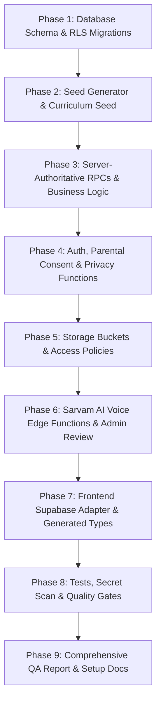

# TamilPalam (தமிழ் பாலம்) — Backend Implementation Plan

## 1. Overview & Strategy
This plan coordinates the end-to-end implementation of the Supabase backend for TamilPalam. All changes adhere strictly to:
1. **Zero UI Regressions:** The React frontend interfaces (`src/services/*`) must be satisfied with zero breakages to any screen or component.
2. **Server-Authoritative Progression:** XP, streaks, mastery, SRS intervals, and Tanglish stages run exclusively in PostgreSQL `SECURITY DEFINER` functions.
3. **Child Privacy & Safety First:** Strict COPPA 2.0 and GDPR-K compliance with verified parental consent, cascade data erasure, and private ephemeral recording retention.
4. **Sarvam AI Voice-Only Integration:** Documented, tested TTS/STT pipelines with human-reviewed audio staging and zero unconstrained generative AI.

---

## 2. Implementation Phases

### Phase 1: Database Schema & RLS Migrations
- Initialize `supabase/` directory with `config.toml`.
- Create ordered SQL migrations in `supabase/migrations/`:
  - `00001_core_schema.sql`: Profiles, user_preferences, user_roles, learning_levels, lessons, lesson_items, tamil_letters, vocabulary_items, exercises, questions, answer_options.
  - `00002_progress_gamification.sql`: Lesson_progress, quiz_attempts, learner_skill_mastery, revision_queue, achievements, user_achievements, daily_learning_activity, streaks, xp_ledger, missions, mission_progress.
  - `00003_audio_safety_audit.sql`: Audio_assets (with reviewer fields), speaking_recordings (with 24h expires_at), consent_records, parent_child_relationships, content_reports, feature_flags, voice_usage, analytics_events, audit_log.
  - `00004_triggers_indexes.sql`: Timestamps trigger, Unicode NFC normalization triggers on all Tamil text fields, indexes on all foreign keys, query filters, and RLS columns.
  - `00005_rls_policies.sql`: Default deny on all tables in `public` schema. Optimal `(SELECT auth.uid())` pattern. Owner-isolated learner data, public read for approved curriculum and assets, parent read-only access for verified children, admin role checks.

### Phase 2: Seed Generator & Curriculum Seed
- Create `scripts/generate-seed.ts` (or `.js`):
  - Ingests single source of truth directly from `src/data/curriculumData.ts`, `src/data/audioManifest.ts`, `src/data/badgesData.ts`, `src/data/missionsData.ts`, and `src/data/assessmentData.ts`.
  - Normalizes all Tamil text to Unicode NFC.
  - Generates `supabase/seed.sql` loading Levels 0–4 curriculum, letters (including ஃ), vocabulary, exercises, questions, answer options, badges, and missions.
  - Validates seed content using `scripts/validate-tamil.js` and flags any ambiguous strings with `needs_review = true`.

### Phase 3: Server-Authoritative Logic & RPCs
- Migration `00006_rpc_functions.sql`:
  - `submit_item_answer(p_profile_id, p_skill_type, p_item_id, p_is_correct, p_difficulty)`: Updates mastery score with exponential recency decay ($\lambda = \ln(2)/14$), updates Tanglish stage (A–E) with automatic regression on drop, and schedules next review in `revision_queue` (intervals 1, 3, 7, 14, 30, 60 days; reset on failure).
  - `complete_lesson(p_profile_id, p_lesson_id, p_correct_count, p_total_count, p_time_spent, p_idempotency_key)`: Idempotent lesson completion, awards XP (10 per correct + 5 completion + 50 level completion), updates streak with 1-day automatic grace and weekly freeze, evaluates and unlocks achievements.
  - `get_resume_point(p_profile_id, p_lesson_id)`: Fetches exact resume index and state.
  - `get_dashboard_summary(p_profile_id)`: Aggregates current streak, total XP, script power stage/percentage, and daily goal progress.
  - `get_due_revision_items(p_profile_id)`: Returns SRS items where `next_review_at <= now()`.
  - `recommend_next_lesson(p_profile_id)`: Rule-based recommendation engine returning recommended lesson ID and transparent human-readable "Why this" explanation.
  - `calculate_starting_level(p_assessment_answers)`: Evaluates initial 10-question placement score.
  - `link_parent_child(p_parent_email, p_child_id, p_verification_code)`: Establishes verified parent link.
  - `get_parent_summary(p_child_profile_id)`: Read-only summary for parent dashboard.

### Phase 4: Auth, Parental Consent & Child Privacy
- Implement child account safeguards:
  - DOB detection; users under 13 require parental consent.
  - Edge Functions:
    - `parent-consent-request`: Dispatches verification email/code to parent.
    - `parent-consent-confirm`: Validates code, records legally compliant entry in `consent_records`, activates child account.
    - `export-my-data`: Compiles complete GDPR JSON archive of learner profile, progress, quiz attempts, and mastery.
    - `delete-account`: Executes complete cascade erasure across database, storage, and GoTrue user record.

### Phase 5: Storage Buckets & Access Policies
- Create Supabase storage buckets:
  - `audio`: Public read CDN for approved, reviewed lesson audio. Write restricted to admin/service_role.
  - `audio-staging`: Private bucket for draft batch TTS generated by Sarvam AI. Write restricted to admin/service_role.
  - `recordings`: Private bucket for ephemeral learner speaking recordings organized by `{user_id}/{recording_id}.webm`. Access restricted to owner; hard-deleted after 24 hours.

### Phase 6: Voice Pipeline (Sarvam AI Integration)
- Verified against `https://api.sarvam.ai` official documentation:
  - `tts-generate-batch`: Admin function for batch generation of letter, word, and sentence audio using Bulbul model (`bulbul:v1` / `bulbul:v4-flash`), saving into `audio-staging` as `pending_review`.
  - `admin-review-audio`: Admin endpoint to approve/reject staged audio; approved assets are copied to public CDN `audio` bucket.
  - `tts-get`: Authenticated, rate-limited on-demand TTS with content hash caching (`sha256(text + voice + pace)`) to ensure identical text never hits Sarvam twice.
  - `stt-transcribe`: Feature-flagged speaking practice using Saaras (`saaras:v4`). Performs tolerant Tamil string similarity comparison server-side. Presented as "speech recognition match", never as pronunciation grading.
  - `cleanup-recordings`: Background worker that deletes speaking recordings older than 24 hours.

### Phase 7: Frontend Integration (Supabase Adapter)
- Generate TypeScript types from schema (`src/types/database.ts`).
- Create `src/services/supabaseClient.ts` configured from environment variables.
- Implement `src/services/supabaseAdapter.ts` supporting all domain services:
  - Wire `authService`, `curriculumService`, `progressService`, `masteryService`, `tanglishService`, `revisionService`, `missionService`, and `parentService` to use Supabase when configured.
  - Support fallback to `LocalStorageAdapter` when `VITE_USE_MOCK_STORAGE === 'true'`.
  - Ensure zero raw error messages: handle loading, empty, and offline states using PRD Section 71 error strings.

### Phase 8: Testing, Secret Scanning & Quality Gates
- SQL / pgTAP tests for:
  - RLS policies (isolation between users, parent read-only, admin privileges).
  - RPC logic (XP idempotency, mastery decay math, SRS intervals, streak grace).
  - Cascade deletion on account removal.
- Edge Function unit/integration tests with Sarvam API mocked.
- Secret scan script to ensure `SARVAM_API_KEY` and `SUPABASE_SERVICE_ROLE_KEY` are never in the client bundle.
- Build test: `npm run build` succeeds cleanly with zero TypeScript errors.
- Vitest tests: All existing and new tests pass.

### Phase 9: Quality Assurance Report & Documentation
- Document results in `docs/BACKEND_QA_REPORT.md`.
- Provide `.env.example` with clear placeholders.
- Update `README.md` with complete backend setup instructions.
