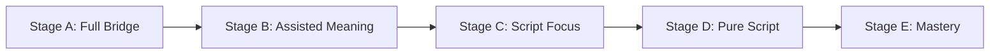

# TamilPalam (தமிழ் பாலம்) — Product Understanding Document

## 1. Executive Summary & Product Vision
**TamilPalam** ("Tamil Bridge") is an engaging, gamified, audio-first Tamil learning web application purpose-built for school students (Standards 1 to 12) from non-Tamil-speaking backgrounds, heritage diaspora learners, and migrant children with little or no prior Tamil knowledge.

The platform bridges the gap between zero knowledge and confident Tamil literacy by starting with familiar phonetic Roman script (**Tanglish**) and systematically scaffolding students towards authentic Tamil script literacy (**தமிழ்**), oral fluency, and cultural appreciation.

---

## 2. Target Audience & Three Age Modes
While the platform covers curriculum from Standard 1 to Standard 12, the experience adapts fluidly across three distinct age modes sharing a unified codebase and design system:

### 1. Sprouts (Standards 1–3, ~ages 6–9)
- **Pedagogy & Interaction:** Pre-readers and early readers. Audio-led and visual-icon-led. Almost no text-heavy instructions; spoken Tamil/English audio prompts accompany at most 6 words of text.
- **Physical Affordances:** Tap-to-select and tap-to-place exclusively (no complex drag-and-drop, no swipe gestures, no hover, no long-press, no small close buttons).
- **Sizing:** Minimum touch target **64px**, primary buttons **72px** tall. Tamil glyphs rendered large at **96px–140px**. Single primary action per view.
- **Session Length:** 5 activities per lesson (~5 minutes), segmented visual progress bars (no abstract percentages).

### 2. Explorers (Standards 4–6, ~ages 9–12) — Primary Focus
- **Pedagogy & Interaction:** Fluent English readers. Multi-modal inputs: tap-to-place plus optional drag-and-drop with keyboard fallbacks.
- **Physical Affordances:** Minimum touch target **52px**. Tamil glyphs rendered at **40px–72px**.
- **Features:** Rich feedback, real-life missions, streak calendar, badge trophy shelf, and companion mascot hints (**Kili the Parrot / கிளி**).
- **Session Length:** 6–8 activities per lesson (~8–10 minutes).

### 3. Scholars (Standards 7–12, ~ages 12–18)
- **Pedagogy & Interaction:** Mature learners, high school students, and heritage young adults. Denser layout, tighter radius tokens, subtler heritage colors, rapid lesson cadence.
- **Affordances:** Mascot-free, minimal cartoonish elements, option to skip repetitive oral drills, direct focus on script mastery, grammar, and literary nuance. Minimum touch target **44px**.

---

## 3. Curriculum Framework (Levels 0 to 7) & CEFR Alignment

| Level | CEFR Equivalent | Title & Description | Target Skills | Tanglish Policy |
| :--- | :--- | :--- | :--- | :--- |
| **Level 0** | Pre-A1 | **Tamil Discovery (தொடக்க நிலை)** | Discover Tamil script, cultural orientation, phonetic awareness, baseline assessment. | Full Tanglish (Stage A) |
| **Level 1** | Pre-A1 | **Vowels & Basic Consonants (உயிரும் மெய்யும்)** | 12 Uyir vowels (அ–ஔ), 1 Aytham (ஃ), first 6 Mei consonants (க்–ட்), animated tracing, audio phonics. | Full Tanglish + Audio (Stage A/B) |
| **Level 2** | A1 (Receptive) | **First Words & Everyday Things (முதல் சொற்கள்)** | 50+ basic words (family, greetings, colors, numbers 1–10, animals, food) with pictures and audio. | Tanglish on Demand (Stage B) |
| **Level 3** | A1 | **Syllables & Early Reading (உயிர்மெய் எழுத்துக்கள்)** | Consonant-vowel combinations (Uyirmei), 2–3 syllable word reading, matching games. | Tanglish on Demand (Stage B/C) |
| **Level 4** | A1+ | **Simple Sentences & Self (எளிய வாக்கியங்கள்)** | Sentence building (Subject-Object-Verb), family descriptions, basic questions, word ordering. | Tanglish Fading (Stage C) |
| **Level 5** | A2 (Listening) | **Conversations & Actions (உரையாடல்கள்)** | Daily conversational dialogues (shopping, school, asking directions), listening comprehension. | Minimal Tanglish (Stage D) |
| **Level 6** | A2 | **Short Stories & Reading (கதைகளும் வாசிப்பும்)** | Short paragraph reading, cultural narratives (Panchatantra, Pongal), reading comprehension quizzes. | Pure Tamil / Hidden Tanglish (Stage D/E) |
| **Level 7** | A2+ | **Real-World Tamil & Heritage (நடைமுறைத் தமிழ்)** | Complex sentences, real-life missions, cultural proverbs, Thirukkural couplets, self-expression. | Pure Tamil Mastery (Stage E) |

---

## 4. The 5-Stage Progressive Tanglish Reduction (PTR)
Tanglish serves strictly as a temporary cognitive bridge, not a permanent crutch. The platform visualizes this progress to learners as an empowering **"Script Power" (எழுத்து ஆற்றல்)** meter.

### Stage Definitions & Transition Criteria
1. **Stage A (Full Support):**
   - *Display:* Tamil Script (always) + Tanglish (always) + English Meaning (always) + Audio (auto-play).
   - *Advance Trigger:* 80% accuracy across 10 items.
2. **Stage B (Meaning On Demand):**
   - *Display:* Tamil Script (always) + Tanglish (always) + English Meaning (tap-to-reveal) + Audio (auto-play).
   - *Advance Trigger:* 85% accuracy across 15 items.
3. **Stage C (Script Focus):**
   - *Display:* Tamil Script (always) + Tanglish (tap-to-reveal) + English Meaning (hidden) + Audio (on demand).
   - *Advance Trigger:* 85% accuracy across 15 items + 3 distinct sessions.
4. **Stage D (Pure Script Immersion):**
   - *Display:* Tamil Script (always) + Tanglish (hidden) + English Meaning (hidden) + Audio (on demand).
   - *Advance Trigger:* 90% accuracy across 20 items.
5. **Stage E (Script Independence / Mastery):**
   - *Display:* Tamil Script (always) + Tanglish (hidden) + English Meaning (hidden) + Audio (hidden / optional).
   - *Advance Trigger:* Mastery confirmed (Score ≥ 0.90).

### Key PTR Rules
- **Non-Punitive Assistance:** A persistent **"Need help? / உதவி தேவை"** button is always present, allowing the learner to reveal Tanglish and audio hints without shame.
- **Item-Level Granular Regression:** If accuracy on a specific letter or word drops below 70%, only that specific item regresses to the previous stage in the revision queue, never demoting the student's global level.
- **Skill Mastery Formula:**
  $$\text{Mastery Score} = \left(\frac{\text{Correct Recalls}}{\text{Total Attempts}}\right) \times \text{Recency Weight} \times \text{Difficulty Modifier}$$
  where recency follows an exponential decay over 14 days ($e^{-\lambda t}$).

---

## 5. Gamification & Child-Ethical Motivation Rules
Built strictly around educational psychology principles (Self-Determination Theory):

- **XP (Experience Points):** 10 XP per correct response, 5 XP on lesson completion, 50 XP per level completion, 20 XP per completed real-life mission. Rewarded for effort and accuracy, never time wasted.
- **Daily Goal Ring:** 1 lesson (default), customizable to 2 or 3 lessons. Celebrated with an immediate SVG ring fill.
- **Streaks & Grace:** Daily streaks require 1 completed lesson. Equipped with **1 free streak freeze per week** and an automatic **1-day grace period**.
- **Badges & Achievements:** Skill-based milestones (e.g., *Uyir Explorer*, *Mei Master*, *Word Collector 25*, *First Sentence*, *Week Warrior*).
- **Prohibited Gamification (Absolute Don'ts):**
  - **NO Lives or Hearts** (children are never locked out of learning because of mistakes).
  - **NO Red punitive failure screens or buzzer sounds.** Wrong answers trigger a warm "Try again" with audio reinforcement and the correct answer explained.
  - **NO Public Leaderboards** (prevents social anxiety and COPPA compliance violations).
  - **NO Loot boxes, gacha rolls, or fake urgency timers.**
  - **NO Guilt-tripping notifications.** Celebrations are concise (<1.5s) and skippable.

---

## 6. Complete Screen Inventory (Section 46)

1. **Screen 1 — Landing Page (`/`):** Hero, value proposition, live English/Tamil interface toggle, interactive 3-step feature demonstration, age-mode preview, direct CTAs (*Start Learning*, *Try Demo*).
2. **Screen 2 — Auth (`/auth`):** Sign Up & Sign In flows with child-safe mock persistence, demo mode quick-bypass.
3. **Screen 3 — Parental Consent Modal / Screen (`/parent-consent`):** Plain-language COPPA/GDPR-K consent for users under 13, verifiable parent email/SMS confirmation mock.
4. **Screen 4 — Onboarding Flow (`/onboarding`):** Welcome introduction, display name selection, grade selection (Std 1–12) which auto-sets initial Age Mode (Sprouts, Explorers, Scholars), and learning preference setup.
5. **Screen 5 — Initial Assessment (`/assessment`):** 10 adaptive questions testing audio phonics, letter recognition, vocabulary, and sentence ordering. Provides an honest level recommendation (Level 0 to Level 4) with student override option.
6. **Screen 6 — Home Dashboard (`/dashboard`):** Daily goal progress ring, current streak status with freeze indicator, "Continue Learning" banner, quick stats, Script Power gauge, and recent badges.
7. **Screen 7 — Level Map (`/learn`):** Interactive 3D-perspective milestone trail spanning Levels 0 through 7, featuring heritage kolam checkpoints, temple-gopuram silhouettes, locked/unlocked visual feedback.
8. **Screen 8 — Lesson Player (`/lesson/:lessonId`):** Central interactive learning engine supporting:
   - *Letter Phonics & Tracing:* SVG outline tracing with animated guidance.
   - *Vocabulary:* Rich visual card, native audio playback, Tanglish bridge toggle.
   - *Multiple Choice (MCQ):* High-contrast cards with instant audio reinforcement.
   - *Matching Pairs:* Tap-to-select and tap-to-match phoneme-to-glyph or word-to-image.
   - *Fill in the Blanks:* Contextual missing letters or words.
   - *Word / Sentence Ordering:* 3D-styled interactive tiles to construct sentences.
   - *Listening Comprehension:* Spoken audio playback at 0.5x/0.75x/1.0x with visual comprehension question.
   - *Speaking Practice:* Record-and-compare audio interface using browser `MediaRecorder`, side-by-side playback with model audio, child-friendly self-assessment prompt, zero AI judgment, local storage with auto-delete.
   - *Reading Comprehension:* Short passage with vocabulary helpers and comprehension checks.
   - *Picture & Cultural Stories:* 4-panel illustrated heritage stories (e.g., "The Clever Crow", "Pongal Feast") with sentence-by-sentence narration.
9. **Screen 9 — Quiz / Lesson Results (`/lesson/:lessonId/results`):** Accuracy breakdown, XP earned, star ratings, weak item remediation recommendations, and celebration modal.
10. **Screen 10 — Progress & Skill Mastery (`/progress`):** Radar/bar visualization of 5 core competencies (Letter recognition, Word reading, Sentence comprehension, Listening, Speaking), streak calendar, and badge trophy showcase.
11. **Screen 11 — Spaced Repetition Revision Queue (`/revision`):** Smart revision deck scheduled at 1, 3, 7, 14, 30, and 60-day intervals to solidify memory.
12. **Screen 12 — Real-Life Tamil Missions (`/missions`):** Practical offline/online micro-missions connecting language to daily life (e.g., "Say வணக்கம் to your grandparents", "Find 3 round objects and name them in Tamil", "Spot a Tamil letter on a sign").
13. **Screen 13 — Profile & Settings (`/profile`):** Grade & Age Mode switcher (Sprouts / Explorers / Scholars), interface language toggle (English/தமிழ்), audio playback speed preference, Tanglish manual override, Reduce Motion toggle, High Contrast mode, and data reset/export.
14. **Screen 14 — Parent Dashboard (`/parent`):** Read-only supervisory dashboard displaying child's weekly activity, time practiced, skill mastery matrix, revision needs, and JSON progress export.
15. **Screen 15 — System & Edge States:** Offline banner with service worker queue, empty revision deck, audio fallback indicator (Web Speech API notice), loading skeletons, and kind error boundaries.

---

## 7. Localisation & Tamil Language Protocol
- **Dual Independent Layers:** The **Interface Language** (English vs. தமிழ்) and **Learning Target Language** (Tamil content) are completely decoupled. A student can navigate in English while learning Tamil, or immerse in a 100% Tamil UI.
- **Zero Hardcoded Strings:** Every UI element, button, tooltip, aria-label, alt text, and validation message is localized via `react-i18next`.
- **Unicode NFC Normalization:** All Tamil text stored, processed, and displayed is normalized to Unicode NFC to avoid broken combining characters.
- **Tamil Typography Guardrails:**
  - Font Stack: `Noto Sans Tamil`, `Noto Serif Tamil`, and fallback system Tamil fonts.
  - Line Height: strictly $\ge 1.8$ to preserve upper vowel signs (ி, ீ) and lower vowel signs (ு, ூ).
  - Explicit `lang="ta"` attribute on every Tamil DOM container.
  - No CSS `text-transform: uppercase`, no letter-spacing, and no text ellipsis truncation that clips ligatures.

---

## 8. Accessibility & Child Safety (COPPA 2.0 & GDPR-K)
- **WCAG 2.1 AA Compliance:** Minimum color contrast of 4.5:1 for normal text and 3:1 for large elements across the heritage palette (Warm Ivory `#FDF8F0`, Deep Charcoal `#1A1A2E`, Heritage Teal `#0F4C5C`, Turmeric Gold `#E8B84B`, Temple Maroon `#7B2D26`, Palm Green `#4A7C59`).
- **Full Keyboard & Focus Management:** Logical tab order, visible focus rings, and skip links.
- **Motor Ergonomics:** Generous hit targets (64px for Sprouts, 52px for Explorers, 44px for Scholars) with at least 12px spacing between interactive elements to prevent accidental mis-taps.
- **Motion Accessibility:** Strict adherence to `prefers-reduced-motion` with an in-app manual toggle to disable 3D flips, springs, and celebrations.
- **Child Privacy Shield:**
  - Verifiable parental consent flow for learners under 13.
  - Zero external tracking, zero analytics beacons, zero third-party ads.
  - Audio recordings for speaking drills remain strictly in browser memory/IndexedDB, are never uploaded to any cloud server, and are auto-deleted after 24 hours.
  - Explicit plain-language microphone consent dialog prior to recording.
